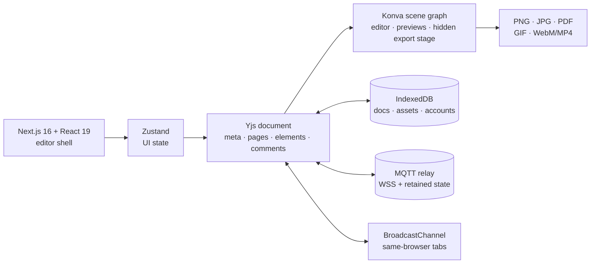

<p align="center">
  
</p>

<h1 align="center">Levele</h1>

<p align="center">
  <strong>An open-source, Canva-style design studio that runs entirely in the browser.</strong><br>
  Fifteen fully editable templates, real layers, smart guides, animation, Present mode, comments and live collaboration.
</p>

<p align="center">
  <a href="https://levele-eight.vercel.app"></a>
  
  
  
  
  
  
</p>

<p align="center">
  <a href="https://levele-eight.vercel.app"><strong>Open the studio</strong></a>
  ·
  <a href="#why-levele">Why Levele</a>
  ·
  <a href="#features">Features</a>
  ·
  <a href="#architecture">Architecture</a>
  ·
  <a href="#run-locally">Run locally</a>
  ·
  <a href="#deploy-to-vercel">Deploy</a>
  ·
  <a href="#limits">Limits</a>
</p>

---


Levele is a local-first design editor for social posts, stories, posters, presentations, resumes, thumbnails, invitations and business cards. Start blank or from a template, edit every text box and shape, animate the page, then export a PNG, multi-page PDF, GIF or short video. No account is required to begin.

A **NODAYSIDLE** open-source project. MIT licensed.

---

## Why Levele?

Most browser design tools are excellent products wrapped around an account wall, a subscription and a document you can never fully own. Levele is the opposite: a complete editing surface you can clone, self-host and extend, with the design stored in your browser and a live session that works without an application server.

| Constraint in typical design tools | How Levele handles it |
| :--- | :--- |
| **Sign-up before the first canvas** | Guest mode from the first click. Accounts are optional and local. |
| **Cloud-only documents** | Autosave to IndexedDB. Guest designs survive refresh and signup claims them. |
| **Flattened template exports** | Templates are normal layers — text, shapes, icons, images, stickers and backgrounds. |
| **No real collaboration without a paid seat** | Yjs over MQTT plus BroadcastChannel, with presence, cursors and remote selections. |
| **Closed, vendor-hosted editor** | MIT licensed. Next.js, Konva, Yjs and MQTT; deployable to Vercel in one command. |
| **Analytics and tracking by default** | No product analytics or tracking. Fonts and live sync are the only optional network surfaces. |
| **“Export” means a screenshot** | PNG/JPG, multi-page PDF, animated GIF and short video from a hidden full-resolution stage. |

---

## Features

| Area | Capability |
| :--- | :--- |
| **Formats** | Social post, story, poster, presentation, resume, thumbnail, invitation and business card — plus custom dimensions. |
| **Templates** | 15 starter designs: launch post, quote, lifestyle post, sale story, travel story, jazz poster, exhibition poster, 5-slide pitch deck, 3-slide portfolio, A4 resume, YouTube thumbnail, wedding + birthday invitations and two business cards. **Every layer is editable.** |
| **Elements** | Text, 11 shapes, 113 Lucide icons, photos, 41 emoji stickers, solid/gradient/pattern/image backgrounds. |
| **Editing** | Move, resize, rotate, multi-select, marquee selection, grouping, lock/hide, opacity, duplicate and delete. |
| **Layout** | Layers panel with drag reordering, z-order controls, six alignment modes, distribution, smart snapping to page edges/centre/layers, coral guide lines and a toggleable grid. |
| **Typography** | 12 typefaces, numeric weights, italic, underline, uppercase, horizontal/vertical alignment, line height, letter spacing, highlight backgrounds, inline canvas editing and an inspector content field. |
| **Photos** | 16 bundled sample images, local uploads (downscaled), cover/contain fitting, rounded corners and colour overlays. |
| **Pages** | Add, duplicate, rename, reorder and delete pages; page transitions and autoplay duration. |
| **Animation** | Fade, rise, drop, slide, zoom, spin and pop entrances; float, pulse and wiggle loops; delay, duration and easing. |
| **Present** | Full-screen mode with page transitions, autoplay, progress bar, fullscreen and keyboard navigation. |
| **Export** | PNG/JPG at 1×/2×/3×, multi-page PDF (A4 mapping for print formats), animated GIF, and WebM/MP4 video via MediaRecorder. |
| **Saving** | Debounced IndexedDB autosave, generated dashboard thumbnails and save-status indicator. |
| **Accounts** | Guest profile, optional local accounts with PBKDF2-SHA256 passwords, guest-design claiming, sign-in/out. |
| **Sharing** | Live collaboration link, independent snapshot-copy link, downloadable `.levele.json` project file and dashboard import. |
| **Collaboration** | Yjs CRDT updates over MQTT + BroadcastChannel; presence avatars, remote cursors, remote selections and synced comments. |
| **Comments** | Pins on the canvas, threads, replies, resolve/reopen and delete; comments travel with the design. |
| **Responsive** | Desktop-first editor with touch editing, drawer panels, a pan tool and zoom controls for phones/tablets. |

### Template library

| Category | Templates |
| :--- | :--- |
| Social | Make it bold · Quiet quote · Slow mornings |
| Story | Big weekend sale · The quiet north |
| Poster | Jazz night · Form & function |
| Presentation | Northwind pitch (5 slides) · Fieldwork portfolio (3 slides) |
| Resume | Editorial resume (A4) |
| Thumbnail | 30-day experiment |
| Invitation | Amara & Noah · Thirty, flirty |
| Business card | Studio North (2 sides) · Elena Marsh |

---

## Architecture



### Document model

A design is a plain `DesignDoc`: width/height, pages, a flat list of typed elements and comment threads. Every element carries position, size, rotation, opacity, z-order, optional group ID and animation settings. Pages own backgrounds, transitions and autoplay duration.

The Yjs document stores the same data in four maps (`meta`, `pages`, `elements`, `comments`), so concurrent edits merge per page/element. A React snapshot is rebuilt on each CRDT update; the editor's local mutations are tagged `levele-local` and only those are tracked by `Y.UndoManager`, so undo never reverses a collaborator's work.

### Canvas

Konva renders the page at its true pixel size. Elements use their centre as the rotation origin, which makes resize/rotate behave like a design tool. Drags and transforms are committed once on pointer-up to keep undo history clean. Page content is clipped to the page bounds; selection overlays live above the clip.

A second hidden stage renders at document resolution for exports. Exports wait for images, icon caches and `document.fonts.ready`, then rasterise PNG/JPG/PDF, step animation time for GIF quantization, or stream the stage into a recording canvas for video.

### Live collaboration

`src/lib/editor/mqtt-provider.ts` publishes Yjs updates to `levele/v1/<room>/doc` and keeps a retained full-state message for bootstrap. A joining peer requests a sync, receives the latest state and can start editing immediately. Awareness messages carry user, page, selection and cursor; stale presence expires after 25 seconds. BroadcastChannel mirrors updates between tabs in the same browser.

There is no application server. The default relay is the public EMQX test broker, and a private WSS broker can be supplied with `NEXT_PUBLIC_MQTT_URL`.

---

## Run locally

Requires **Node.js 20.9+** (22 LTS recommended).

```bash
git clone https://github.com/nodaysidle/levele.git
cd levele
npm install
npm run dev
# http://localhost:3000
```

If port 3000 is occupied, Next.js picks the next free port automatically.

```bash
npm run typecheck   # strict TypeScript
npm run build       # production build
npm start           # serve the production build
```

---

## Deploy to Vercel

```bash
npx vercel login
npx vercel --prod
```

Or import the repository in the [Vercel dashboard](https://vercel.com/new). Next.js is auto-detected; no `vercel.json` or environment variables are required.

Optional environment variables:

```bash
# Private MQTT relay for multi-device live collaboration.
NEXT_PUBLIC_MQTT_URL=wss://your-broker.example.com:8084/mqtt

# Canonical URL used to resolve Open Graph images.
NEXT_PUBLIC_SITE_URL=https://your-domain.example
```

Default production deployment: <https://levele-eight.vercel.app>

---

## Testing

```bash
npx playwright install chromium
npm run dev
BASE_URL=http://localhost:3000 npm run test:smoke
```

The smoke test creates a design, adds text, opens Present mode, downloads a PNG, opens the share dialog, returns to the dashboard and asserts the design was saved. The deployed build was tested at <https://levele-eight.vercel.app> with the same suite.

Manual verification covered drag/resize/rotate/group, snapping guides, page management, PNG/JPG/PDF/GIF/WebM outputs, project import/export, local accounts, comments and cross-context live editing (title, layers, presence, cursors and comments).

---

## Project structure

```text
levele/
├── src/app/                         # Next.js App Router
│   ├── page.tsx                     # dashboard / landing
│   ├── editor/[id]/page.tsx         # editor route
│   ├── layout.tsx, globals.css      # metadata, fonts, design system
│   └── icon.svg
├── src/components/
│   ├── canvas/                      # Konva renderer + previews
│   ├── editor/                      # shell, canvas, panels, dialogs, present mode
│   ├── dashboard/                   # dashboard + new-design dialog
│   └── ui/                          # modal, toasts, spinner
├── src/lib/
│   ├── editor/                      # types, templates, Yjs, MQTT, store, geometry, animation
│   ├── export/exporter.ts           # PNG/JPG/PDF/GIF/video + project file
│   ├── storage/                     # IndexedDB docs/assets/accounts
│   ├── share.ts, uploads.ts
│   └── ...
├── public/photos/                   # sample photography + credits
├── docs/                            # README screenshots
├── scripts/generate-icons.mjs       # regenerate 113 Lucide icon paths
├── tests/smoke.mjs                  # Playwright smoke test
└── public/og.png, icon.svg, robots.txt
```

---

## Limits

Levele is a working, deployed editor rather than a finished commercial product. The deliberate boundaries:

| Area | Status |
| :--- | :--- |
| **Accounts** | Local-first only: IndexedDB + PBKDF2, no server auth or cross-device library sync. |
| **Live sync** | Public MQTT relay by default; room links are the secret, payloads are not end-to-end encrypted and the broker may retain the latest state. Use `NEXT_PUBLIC_MQTT_URL` for private work. |
| **Permissions** | Link-based editing only; no view-only role or password-protected room. |
| **Share URLs** | Snapshots are capped around 12 KB compressed. Designs with uploads usually need the live link or project file. |
| **Images** | PNG/JPG/GIF/video export the current page; PDF exports all pages. |
| **PDF** | Pages are rasterised, not vector text. |
| **Video** | WebM on most browsers, MP4 only where MediaRecorder supports it; no audio. |
| **Animation** | Presets and loops, not a keyframe timeline. |
| **Editing extras** | No image crop, filters, background removal, arbitrary font upload, SVG import or pinch-to-zoom. |
| **Undo** | Session-only; not persisted across reloads. |
| **Tests** | Playwright smoke suite plus documented manual checks, not exhaustive visual regression. |

---

## Privacy & security

- **No product analytics or tracking.** There is no telemetry script, ad SDK or third-party product analytics in the app.
- **Designs are local by default.** Documents, uploads, thumbnails and local accounts live in IndexedDB in the current browser.
- **Passwords** are hashed with PBKDF2-SHA256 (150,000 iterations, random salt) using Web Crypto. They never leave the device.
- **Fonts** are loaded from Google Fonts. The photo library is bundled locally.
- **Live links** sync through the configured MQTT broker. Treat the room link as the password; do not use the public default relay for confidential material.
- **Snapshot links and project files** contain the design. They are portable by design; share them deliberately.

---

## Credits

- Photography: [Lorem Picsum](https://picsum.photos) / Unsplash — see [`public/photos/CREDITS.md`](public/photos/CREDITS.md).
- Icons: [Lucide](https://lucide.dev), ISC licensed.
- Typefaces: Google Fonts, under their respective OFL licenses.
- Built with [Next.js](https://nextjs.org), [React](https://react.dev), [Konva](https://konvajs.org), [Yjs](https://yjs.dev), [MQTT.js](https://github.com/mqttjs/MQTT.js), [Tailwind CSS](https://tailwindcss.com), [jsPDF](https://github.com/parallax/jsPDF), [gifenc](https://github.com/mattdesl/gifenc) and [idb](https://github.com/jakearchibald/idb).

## License

MIT © [NODAYSIDLE](https://github.com/nodaysidle). See [LICENSE](LICENSE).
