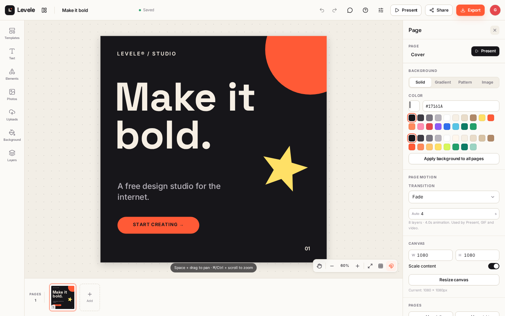

# Levele

**An open-source, Canva-style design editor that runs entirely in the browser.**

Levele is a local-first design studio for social posts, stories, posters, slides, resumes,
thumbnails, invitations and business cards. Start blank or from a template, then edit every
text box, shape, icon, photo, sticker and background. Present your work, collaborate live, and
export to PNG, JPG, PDF, GIF or video.



**Live demo:** [levele-eight.vercel.app](https://levele-eight.vercel.app)

## Quick start

```bash
npm install
npm run dev
# open http://localhost:3000
```

Requirements: Node.js **20.9+** (22 LTS recommended), npm 10+.

Useful checks:

```bash
npm run typecheck   # strict TypeScript
npm run build       # production build (Next.js / Turbopack)
npm start           # serve the production build
```

## Deploy to Vercel

```bash
npx vercel login
npx vercel --prod
```

Or connect the repository in the Vercel dashboard. Vercel auto-detects Next.js 16; no
`vercel.json` is required and no environment variables are needed for the default feature set.

Optional environment variables:

```bash
# Point live collaboration at your own private MQTT broker (WSS).
NEXT_PUBLIC_MQTT_URL=wss://your-broker.example.com:8084/mqtt
```

The default relay is the public EMQX test broker (`wss://broker.emqx.io:8084/mqtt`), which
requires no account or key.

## Tech stack & why

| Layer | Choice | Why |
| --- | --- | --- |
| Framework | **Next.js 16.4 (App Router) + React 19.3 + TypeScript** | One deployable for landing page, editor routes and metadata; strict types catch the canvas/data-model surface. |
| Canvas | **Konva 10.9 + react-konva 19.3** | A real retained-mode scene graph with transforms, hit testing, clipping and a stage we can rasterize for every export format. |
| State | **Zustand 5 + Yjs 13.6 CRDT** | Local UI state is fast and ephemeral; the document is a CRDT so concurrent edits merge and undo/redo is scoped to the local user. |
| Collaboration | **Yjs over MQTT (WebSocket) + BroadcastChannel** | Works cross-device on Vercel with no backend or API keys; same-browser tabs still sync if the relay is unreachable. |
| Local persistence | **IndexedDB via `idb`** | Designs, accounts, uploads and thumbnails survive refresh and work offline. |
| UI | **Tailwind CSS 4 + hand-built components** | Small design system, no component-library bloat, consistent editor chrome. |
| Export | **jsPDF 4, gifenc, MediaRecorder, Canvas 2D** | Client-side exports with no server round-trip. |
| Links | **lz-string** | Compressed snapshot URLs for copy links. |
| Icons | **Lucide** (113 paths) | Consistent, editable SVG icon set, rendered to canvas via cached data URLs. |

## What is implemented

### Editing
- Blank canvas with 8 document presets **and custom width/height**.
- **15 fully editable starter templates** (social, story, poster, exhibition, 5-slide pitch deck, 3-slide portfolio, A4 resume, YouTube thumbnail, wedding + birthday invitations, two-sided studio card, consulting card).
- Text with 12 typefaces, numeric weights, italic/underline/uppercase, alignment, vertical alignment, line height, letter spacing, highlight background, colour and inline editing (double-click).
- Shapes: rectangle, rounded rectangle, ellipse, triangle, star, diamond, line, arrow, heart, burst, blob — solid/gradient fills, strokes, radius and dashes.
- 113 editable Lucide icons with recolouring and stroke width.
- Photos: 16 bundled sample images, browser uploads (downscaled), cover/contain, rounded corners, overlays.
- 41 emoji stickers.
- Backgrounds: solids, gradients, seven procedural patterns, image backgrounds with overlays.
- Move, resize, rotate, multi-select, marquee selection, grouping/ungrouping.
- Smart snapping to page edges, page centre and other layers, with coral guide lines. Toggle snapping or grid in the zoom bar.
- Alignment (6 modes), distribution, z-order (front/forward/backward/back), lock/hide, opacity, layer drag reordering.
- Full page management: add, duplicate, reorder, rename and delete; pages are the basis of slide decks and PDFs.
- Undo/redo, copy/paste in-app, duplicate, nudge with arrow keys.
- Zoom/pan, fit-to-screen, grid, keyboard shortcuts dialog.

### Animation & presentation
- Per-element entrance animations: fade, rise, drop, slide from left/right, zoom in/out, spin, pop.
- Loops: float, pulse, wiggle.
- Duration, delay, easing (including spring).
- Animation preview in the editor.
- Full-screen **Present mode** with page transitions (fade/slide/zoom), autoplay, progress bar, keyboard navigation and fullscreen.

### Output
- **PNG / JPG** of the current page at 1×, 2× or 3×.
- **Multi-page PDF**, rasterised at 1×/2×/3×. Posters and resumes map to A4; business cards map to 3.5 × 2 in; invitations to 6 × 8 in; other formats use the design dimensions.
- **Animated GIF** of the current page with 8/12/15 fps and 540/720/960 px widths.
- **Short video** of the current page via `MediaRecorder` (WebM VP9/VP8, or MP4 where the browser supports it), 720/1080/1280 px, real-time recording.
- Project handoff: download `.levele.json` and import it from the dashboard, including pages, layers, animations, comments and uploaded images.

### Accounts, saving & sharing
- **No account required**; guest profile created automatically.
- Autosave to IndexedDB with a live save status indicator and generated dashboard thumbnails.
- Dashboard library with search, duplicate, delete, project download/import and template gallery.
- Local accounts with PBKDF2-SHA256 (150k iterations, random salt) and session persistence. Signing up claims designs created as a guest on the same device.
- **Live collaboration** with presence avatars, remote cursors and remote selection outlines.
- **Comments** with pins, threads, replies, resolve/reopen and delete. Comments sync through the CRDT.
- **Share links**:
  - **Live link** — same room, real-time editing. Embeds a compressed snapshot when it fits.
  - **Snapshot copy link** — opens an independent copy (new document ID).
  - **Project file** — offline transfer.

### Responsive
- Responsive marketing/dashboard layouts.
- Editor works on touch devices: tap, drag, resize/rotate handles and panel drawers. No pinch-to-zoom (use the zoom bar).

## What is stubbed, limited or not done

These are deliberate scope boundaries, not hidden placeholders:

- **Accounts are local-first, not server-authenticated.** There is no account database, password reset or cross-device library sync. Live collaboration works cross-device, but the design library lives in each browser. A production build would add a database/auth provider and a storage adapter (the `src/lib/storage/db.ts` boundary is ready for it).
- **Live sync uses a public MQTT relay.** Anyone with a room link can join; payloads are not end-to-end encrypted. Use a private broker via `NEXT_PUBLIC_MQTT_URL` for sensitive work. Same-browser tabs also sync over BroadcastChannel.
- **Snapshot URLs are capped at ~12 KB compressed.** Designs with uploaded images usually exceed that; use the live link while a tab is open, or send the project file.
- **PNG/JPG/GIF/video export the current page only.** PDF exports all pages. There is no “ZIP of every page as PNG”.
- **Video is WebM on most browsers.** MP4 is used only if `MediaRecorder` reports support (some Safari versions). No audio track, no server-side ffmpeg transcode.
- **PDF pages are raster images, not vector text.** Text and photos are embedded at export resolution.
- **Animations are presets, not a keyframe timeline.** No per-property keyframes, path animation or audio.
- **No image crop, filters, background removal, arbitrary font upload or SVG import.** Uploads are rasterised and downscaled.
- **Share permissions are link-based.** There is no view-only role, password-protected room or server-enforced access control.
- **Multi-select transform** scales all selected layers as a group; extremely rotated multi-selections may look slightly skewed compared with a dedicated group node.
- **Mobile editing** is functional but desktop-first; no pinch gesture, no long-press context menus.
- **Test coverage is a smoke suite**, not an exhaustive visual-regression suite.
- **Undo history is per-session** and is not persisted across reloads.

## How it works

### Document model
A design is `DesignDoc` (`src/lib/editor/types.ts`): metadata, pages, a flat list of elements, and comments. Elements carry position, size, rotation, opacity, z-order, optional `groupId`, animation and type-specific props. Pages own backgrounds, transitions and autoplay duration.

The Yjs document stores the same data in maps (`meta`, `pages`, `elements`, `comments` in `src/lib/editor/ydoc.ts`) so concurrent updates merge per element/page. A React snapshot is rebuilt from the CRDT on each update and exposed through Zustand (`src/lib/editor/store.ts`). Local mutations run in transactions tagged `levele-local`; `Y.UndoManager` tracks only those, so undo never reverses a collaborator’s edit.

### Canvas
`CanvasStage` renders one Konva stage at the document’s true pixel size, with a fit-to-viewport transform. Elements are Konva groups with their rotation origin at the centre (`offsetX/offsetY`), which makes resize/rotate behave like a design tool. Drags and transforms are committed once on pointer-up, keeping undo history clean; the transformer attaches to the selected element groups. Page content is clipped to the page so off-canvas artwork doesn’t bleed into the workspace.

### Collaboration
`src/lib/editor/mqtt-provider.ts` publishes/receives Yjs updates over MQTT topics (`levele/v1/<room>/doc|state|sync|awareness/+`) and mirrors them over BroadcastChannel. Retained full-state messages let a joining peer bootstrap immediately; peers also answer sync requests. Awareness carries user, page, selection and cursor. Presence expires after 25 seconds without a heartbeat.

### Exports
A hidden full-resolution stage (`ExportStage`) renders the page at document size. Exports wait for images, icons and `document.fonts.ready`, then:
- rasterise via Konva for PNG/JPG/PDF;
- step animation time and quantise frames with `gifenc` for GIF;
- stream the hidden stage into a recording canvas for `MediaRecorder` video.

### Storage
`src/lib/storage/db.ts` wraps IndexedDB stores for `docs`, `accounts` and `assets`. Autosave debounces 850 ms, stores the whole JSON snapshot plus a 420 px JPEG thumbnail, and runs after every local or remote change. Uploads are capped at 1600 px and stored inline in the document so project files and live updates stay portable.

## Project map

```
src/
  app/
    page.tsx                 Dashboard / landing
    editor/[id]/page.tsx     Editor route (client shell in Suspense)
    layout.tsx, globals.css  Metadata, fonts, design system
  components/
    canvas/                  Konva renderer (elements, backgrounds, previews)
    editor/                  Shell, canvas stage, panels, inspector, dialogs,
                             present mode, page strip, comments
    dashboard/               Dashboard, new-design dialog
    ui/                      Modal, toasts, spinner
  lib/
    editor/
      types.ts               Document/element types
      defaults.ts            Sizes, fonts, palettes, factories
      templates.ts           15 template definitions
      ydoc.ts                Yjs schema + mutations
      session.ts             Session, undo, autosave, collaboration facade
      mqtt-provider.ts       Yjs over MQTT + BroadcastChannel
      store.ts               Zustand UI/document bridge
      geometry.ts            Snapping, bounds, alignment maths
      animation.ts           Presets, easing, page duration
      icons.ts               Generated Lucide path library
      random.ts              Client ID helper
    export/exporter.ts       PNG/JPG/PDF/GIF/video + project file
    storage/db.ts            IndexedDB docs/accounts/assets
    storage/auth.ts          Guest + PBKDF2 accounts
    share.ts                 Snapshot/live link generation
    uploads.ts               Image downscaling
  types/gifenc.d.ts          Type declarations for gifenc
scripts/generate-icons.mjs   Regenerate the icon library
tests/smoke.mjs              Playwright smoke test
public/photos/               Bundled sample photography + credits
```

## Testing

```bash
npx playwright install chromium   # once
npm run dev                       # in another terminal
BASE_URL=http://localhost:3000 npm run test:smoke
```

The smoke test creates a design, adds text, opens Present mode, exports a PNG, opens
the share dialog, returns to the dashboard and asserts that no console/page errors occurred.

During development the full flow was also verified in Chromium: drag/resize/rotate/group,
snapping guides, page add/duplicate/reorder/delete, PNG/JPG/PDF/GIF/WebM downloads,
template application, project download/import, account signup/sign-in/sign-out, comments,
and cross-browser-context live editing (title, layers, presence, cursor and comment sync).

## Credits

- Photography: [Lorem Picsum](https://picsum.photos) / Unsplash — see
  [`public/photos/CREDITS.md`](public/photos/CREDITS.md).
- Icons: [Lucide](https://lucide.dev), ISC.
- Typefaces: Google Fonts (OFL).
- Built with Next.js, React, Konva, Yjs, MQTT.js, Tailwind CSS, jsPDF, gifenc and idb.

## License

MIT. See [LICENSE](LICENSE).
